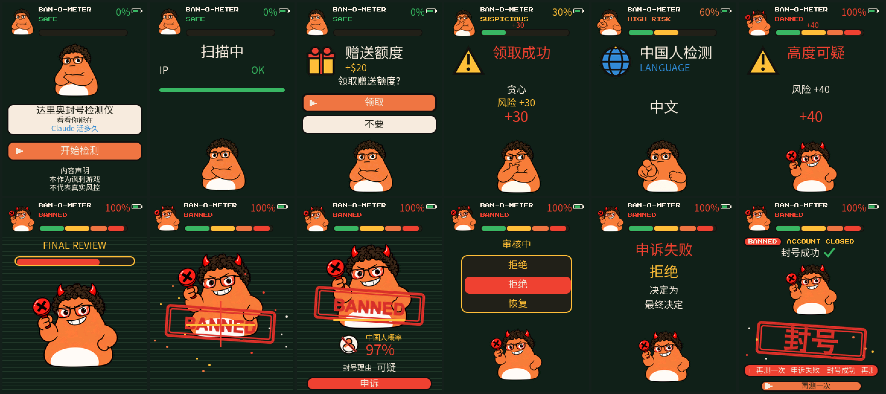
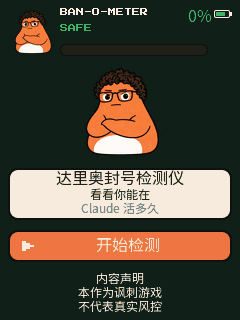
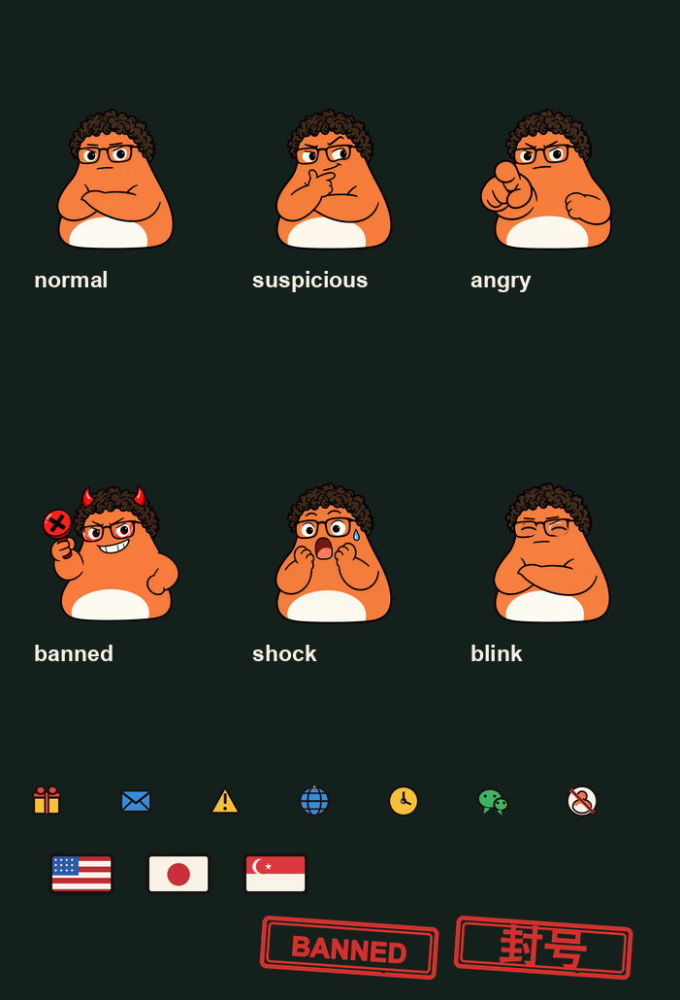

<p align="right">
  <a href="README.zh_CN.md">简体中文</a> · <strong>English</strong>
</p>

<h1 align="center">Dario Ban-o-meter</h1>

<p align="center">DARIO BAN-O-METER™ · How long can you last on Claude</p>

<p align="center">
  
  
  
  
  <a href="https://x.com/cgnot996"></a>
  
</p>

A satirical game for the [FoloToy AI Passport](https://github.com/FoloToy/ai-passport). Three keys, one 240x320 screen, about half a minute. The meter scans, draws three events from a pool of five, stamps a ban, and runs an appeal whose last cell is always reject. Every check on screen is a scripted animation. The firmware does not read your network, language, time zone, apps, or account.

> **Unofficial.** Not affiliated with Anthropic or FoloToy. Flashing replaces the firmware already on the device. Back up first if you still want that image. Proceed at your own risk.

The board support comes from FoloToy's MIT firmware. This game's screens, rules, drawings, and blips are in the same repository, under the same MIT license ([`LICENSE`](LICENSE)). On-screen copy is Chinese. The lines are in [`docs/game-design.zh_CN.md`](docs/game-design.zh_CN.md). A short English summary of the rules is [`docs/game-design.md`](docs/game-design.md).

## Screens

<p align="center">
  
</p>

<p align="center">Home, scan, gift, gift result, the scripted language check, its result, final review, the stamp, the ban page, the appeal reel, appeal failed, game over.</p>

<p align="center">
  
</p>

<p align="center">
  
</p>

<p align="center"><strong>Host preview renders</strong> from <code>tools/preview</code>. Not photographs of the Passport. The GIF is the preview's key frames of one scripted round (gift, mail, then the language check), held long enough to read. It is not a realtime capture. The panel on the device has rounded corners. These frames are square 240 by 320.</p>

## Play

| | |
|---|---|
| Home | **OK** starts. The page stays up if you do nothing |
| Scan | 2.5 seconds. The alert line takes the last 0.5 seconds. The IP, device, language, and identity rows are scripted |
| Three events | Drawn from the five below, no repeat in one round |
| Final review | 2 seconds, then the stamp (0.8 seconds), whatever the total was |
| Ban page | A probability from 81 to 99, and one fixed reason. Waits for **OK** |
| Appeal | 3.2 seconds, eight cells. The last cell is always reject. The result holds for 1.8 seconds |
| Game over | **OK** starts another scan. 25 seconds with no key returns to the home page |

| Event | Keys | Risk |
|---|---|---|
| Gift credit | take, or refuse | +30 or +20 |
| Security mail | open the link, or ignore | +30 or +25 |
| Language check | none. Scripted "Chinese", GMT+8, then WeChat | +40 |
| VPN hop | none. Flags in order: US, JP, SG | +25 |
| Do nothing | none. Counts 3, 2, 1 | +30 |

There is no safe choice. The meter caps at 100. Auto events run for 4 seconds, then show the result for 2.2 seconds. A choice event waits.

## Risk

| Risk | Label | Color |
|---|---|---|
| 0-29 | SAFE | green |
| 30-59 | SUSPICIOUS | yellow |
| 60-79 | HIGH RISK | orange |
| 80-99 | DARIO IS WATCHING | red |
| 100 | BANNED | red |

## Keys

The three keys are one ADC ladder on GPIO0, on the right edge.

| Key | |
|---|---|
| **UP** | Move the highlight up. Only the two choice events use it |
| **DOWN** | Move the highlight down. Same |
| **OK** | Home: start. A choice: confirm. Ban page: open the appeal. Game over: start the next scan |

Other pages ignore the keys. Release every key before you reset the chip. GPIO0 is also the boot strap. Holding a key at reset enters the download mode.

## Character

Six sticker drawings, packed at 160, 96, and 48 px. The firmware does not scale them. Sources are in [`assets/dario/`](assets/README.md).

| Face | Used for |
|---|---|
| normal | Home, the scan, and a risk under 30. This face blinks |
| suspicious | Risk from 30 through 70, and most event results |
| angry | Risk above 70. The sprite shakes by a couple of pixels |
| banned | The second half of the final review, the stamp, the ban page, the appeal, and game over |
| shock | About 420 ms when a result adds 40 or more, and the first time the meter enters 80-99 |
| blink | A short stand-in for normal. Not a separate mood |

## Hardware

| | |
|---|---|
| Chip | ESP32-C3, single core, 160 MHz, about 400 KB SRAM, **no PSRAM** |
| Flash | 8 MB embedded, DIO |
| Display | 240x320 ST7789P3, SPI, rounded corners |
| Audio | ES8311 codec, microphone and speaker over I2S. This game plays five short blips from flash. It does not record |
| Buttons | UP, DOWN, OK on the right edge, one ADC ladder on GPIO0 |
| Battery | CW2017 fuel gauge, 500 mAh |
| USB | The chip's own USB Serial/JTAG (`/dev/cu.usbmodem*` on macOS, `/dev/ttyACM*` on Linux) |

Pins, the panel init table, and the button windows come from FoloToy's BSP (`components/bsp/include/bsp_pins.h`). Deeper hardware notes are in [`docs/hardware-design/AI_HARDWARE_DEVELOPMENT_GUIDE.md`](docs/hardware-design/AI_HARDWARE_DEVELOPMENT_GUIDE.md).

## Prepare

- A FoloToy AI Passport, and a USB cable that carries data.
- macOS or Linux.
- [ESP-IDF v5.5.3](https://docs.espressif.com/projects/esp-idf/en/v5.5.3/esp32c3/get-started/index.html) with the `esp32c3` tools. Other versions are not supported. Do not build this tree with the ESP-IDF 6.0.1 environment used by the Muse port.

Install the toolchain once:

```sh
git clone -b v5.5.3 --recursive https://github.com/espressif/esp-idf.git ~/esp/esp-idf-v5.5.3
~/esp/esp-idf-v5.5.3/install.sh esp32c3
. ~/esp/esp-idf-v5.5.3/export.sh
```

Run `export.sh` again in every new shell. `idf.py --version` must print `v5.5.3`.

Clone this firmware:

```sh
git clone https://github.com/RongleCat/ai-passport-claude-disabled.git
cd ai-passport-claude-disabled
```

## Build

This game has no Wi-Fi credentials and no secrets file. Do not add an SSID or a password to `sdkconfig.defaults` or any tracked file.

```sh
. ~/esp/esp-idf-v5.5.3/export.sh
idf.py set-target esp32c3
idf.py build
```

`idf.py set-target esp32c3` is required on a fresh checkout. Later incremental builds can skip it. The first build downloads LVGL 9.5.0 and the other components listed in `components/bsp/idf_component.yml` into `managed_components/`, which git ignores. `dependencies.lock` pins LVGL 9.5.0. Do not edit those downloaded sources. `sdkconfig` is generated and gitignored. `sdkconfig.defaults` is the tracked baseline.

Host checks, with no device and no IDF shell:

```sh
./tools/validate.sh --static
```

`./tools/validate.sh --firmware` does a second build, then a merged image, for the archive check. Do not flash that merged image. Writing it at `0x0` covers NVS.

## Flash

Three images, three addresses. Bootloader `0x0`, partition table `0x8000`, application `0x10000`. That is what `build/flash_args` lists (`dio`, 80 MHz, `--flash-size 8MB`). NVS at `0x9000` and PHY data at `0xf000` are not in the write, so a later reflash of this same layout keeps them.

**Do not pass `--erase-all`. Do not run `idf.py erase-flash`.** Either one wipes NVS.

The ESP-IDF 5.5.3 environment on the machine that packed this tree is esptool.py v4.12.0. Its help text uses underscores: `--before default_reset`, `--after hard_reset`, `write_flash`, `--flash_mode`, `--flash_freq`, `--flash_size`. esptool v5 renamed those to hyphens: `--before default-reset`, `--after hard-reset`, `write-flash`, `--flash-mode`, `--flash-freq`, `--flash-size`. Use the spelling your `python -m esptool version` prints. The v5 spelling was not executed here.

Release every button first. Turn the Passport on. Switched off, it does not show up on USB. Find the port with `ls /dev/cu.usb*` on macOS or `ls /dev/ttyACM*` on Linux. The port below is an example.

### a. Three bins from a Release

A GitHub Release, when one is published, carries the three bins and `SHA256SUMS`. This git tree does not. `dist/` is gitignored. It is the folder a local build copies into, for the person cutting the Release. The names and addresses:

| File | Address |
|---|---|
| `dario-ban-o-meter-bootloader.bin` | `0x0` |
| `dario-ban-o-meter-partition-table.bin` | `0x8000` |
| `dario-ban-o-meter-app.bin` | `0x10000` |

esptool v4, from the directory that holds the three files:

```sh
python -m esptool --chip esp32c3 -p /dev/cu.usbmodem1101 -b 460800 \
  --before default_reset --after hard_reset \
  write_flash --flash_mode dio --flash_freq 80m --flash_size 8MB \
  0x0 dario-ban-o-meter-bootloader.bin \
  0x8000 dario-ban-o-meter-partition-table.bin \
  0x10000 dario-ban-o-meter-app.bin
```

esptool v5, same addresses and files:

```sh
python -m esptool --chip esp32c3 -p /dev/cu.usbmodem1101 -b 460800 \
  --before default-reset --after hard-reset \
  write-flash --flash-mode dio --flash-freq 80m --flash-size 8MB \
  0x0 dario-ban-o-meter-bootloader.bin \
  0x8000 dario-ban-o-meter-partition-table.bin \
  0x10000 dario-ban-o-meter-app.bin
```

`dist/flash.sh` is the v4 command. It takes the port as its first argument. Each segment must print `Hash of data verified`.

### b. Build, then flash

From the build directory, v4 reads `flash_args` as written by ESP-IDF 5.5.3:

```sh
cd build
python -m esptool --chip esp32c3 -p /dev/cu.usbmodem1101 -b 460800 \
  --before default_reset --after hard_reset \
  write_flash @flash_args
```

On ESP-IDF 5.5.3, `idf.py -p /dev/cu.usbmodem1101 flash` writes the same three images. The Muse port warns against `idf.py flash` because ESP-IDF 6.0.1 splits `SERIAL_TOOL`. That warning belongs to 6.0.1, not to this tree. Still do not erase the chip.

### c. Back up, and put it back

Keep the backup outside git. v4:

```sh
python -m esptool --chip esp32c3 -p /dev/cu.usbmodem1101 read_flash 0 0x800000 ai-passport-backup.bin
```

To put that image back, v4:

```sh
python -m esptool --chip esp32c3 -p /dev/cu.usbmodem1101 write_flash 0 ai-passport-backup.bin
```

v5 spells those `read-flash` and `write-flash`:

```sh
python -m esptool --chip esp32c3 -p /dev/cu.usbmodem1101 read-flash 0 0x800000 ai-passport-backup.bin
python -m esptool --chip esp32c3 -p /dev/cu.usbmodem1101 write-flash 0 ai-passport-backup.bin
```

Opening the serial port often resets the board. Read the log after flashing:

```sh
. ~/esp/esp-idf-v5.5.3/export.sh
idf.py -p /dev/cu.usbmodem1101 monitor
```

Leave the monitor with `Ctrl-]`.

## Cautions

- Do not change `partitions.csv` or the three flash addresses. Restoring another firmware takes a full-chip backup you saved yourself, written back at `0x0`.
- A board that was last flashed with a different layout, such as the Muse port whose application sits at `0x20000`, needs one full erase before this image will boot. That erase deletes NVS. After that, go back to segmented writes and do not keep erasing.
- There is no PSRAM. The blips are samples in flash, not a speech synthesizer. The LVGL heap in this tree is 48 KB.
- If flashing cannot see the port, release every button and try again. If it is still missing, hold a button, tap reset, then release, so the chip enters the download mode.
- Do not point this tree at an ESP-IDF other than v5.5.3. The Muse firmware on the same hardware uses v6.0.1. The two environments do not share a shell.
- The flash commands above match `build/flash_args` and esptool.py v4.12.0's help text. They were not run on a device for this release.

## Project layout

| Path | |
|---|---|
| `main/ban_logic.c` | Rules, copy, RNG. No ESP-IDF and no LVGL |
| `main/ban_ui*.c` | The screens |
| `main/ban_port.c` | Keys, tick, LVGL lock |
| `main/ban_assets.c` | Packed drawings |
| `main/ban_font_*.c` | Font subsets |
| `main/ban_sfx*.c` | The five blips |
| `main/main.c` | Starts the game. The upstream demo menu is not opened |
| `main/demo_*.c`, `main/ui_pixel.c` | Upstream demo sources. They are not in `main/CMakeLists.txt` and are not linked |
| `tools/ban_assets.py`, `tools/ban_fonts.py`, `tools/ban_sfx.py` | Rebuild and `--check` the packed files |
| `tools/preview/` | Host renderer |
| `tools/validate.sh` | Static checks, and a separate firmware check |
| `tests/` | Host tests the static script compiles |
| `assets/dario/`, `assets/sfx/`, `assets/fonts/` | Sources and licenses. See [`assets/README.md`](assets/README.md) |
| `components/bsp/` | Upstream board support |
| `docs/game-design.md` | Rules summary |

## Host preview

No device, no SDL window. From `tools/preview`:

```sh
./render.sh
```

Frames land in `tools/preview/out/`, which git ignores. The pictures in this README are the copies under `docs/assets/preview/`. What the script checks, and how to render into another directory, is in [`tools/preview/README.md`](tools/preview/README.md).

## Privacy and the joke

The scan, the language row, the time-zone row, the WeChat row, the flags, and the probability are a fixed animation plus one random integer from 81 to 99. The firmware does not read IP, GPS, Wi-Fi, system language, time zone, input method, installed apps, accounts, mail, a device id, or browsing history. It does not join a network.

The English line in the firmware is: "Satirical game based on public information and community discussions." The Chinese line is the string returned by `ban_disclaimer_full()` and is printed in [`README.zh_CN.md`](README.zh_CN.md).

## Follow

<p align="center">
  <a href="https://x.com/cgnot996"></a>
  
</p>

<p align="center">
  <a href="https://x.com/cgnot996">Follow @cgnot996 on X</a>
  ·
  On WeChat, search the account name shown on the badge, or scan the code below
</p>

<p align="center">
  
</p>

## License

The baseline firmware and the BSP are FoloToy's, under the MIT license ([`LICENSE`](LICENSE), copyright 2026 FoloToy). The game in this tree is released under the same license (copyright 2026 RongleCat). Both lines are in `LICENSE`. Neither was removed.

| Path | Source | License |
|---|---|---|
| `components/bsp/`, upstream demo sources | FoloToy AI Passport | MIT |
| `main/ban_*`, `tools/ban_*`, `tools/preview/`, `assets/dario/`, `assets/sfx/` | This game | MIT, with this repository |
| `assets/fonts/PressStart2P-Regular.ttf`, `main/ban_font_latin_8.c` | Press Start 2P | SIL OFL 1.1 |
| `main/ban_font_zh_12.c`, `ban_font_zh_16.c`, `ban_font_zh_24.c` | Noto Sans SC Regular, subset | SIL OFL 1.1. The full font is the one LVGL already vendors. It is not copied into `assets/` |

Font files, the reserved names, and the commands are in [`assets/README.md`](assets/README.md). Dependencies fetched at build time keep their own licenses.

FoloToy and AI Passport are FoloToy's. Claude, Anthropic, and the related names are Anthropic's. This project is not endorsed by either of them.
